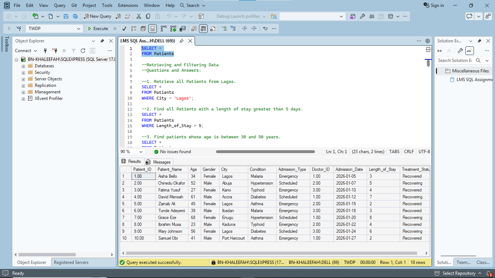
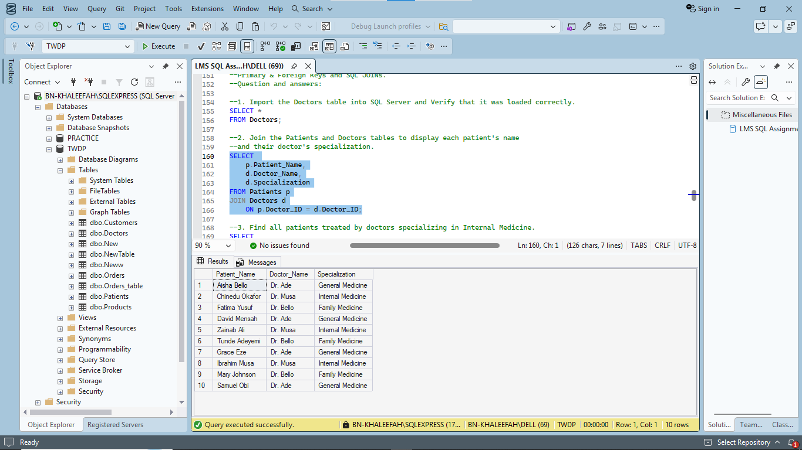
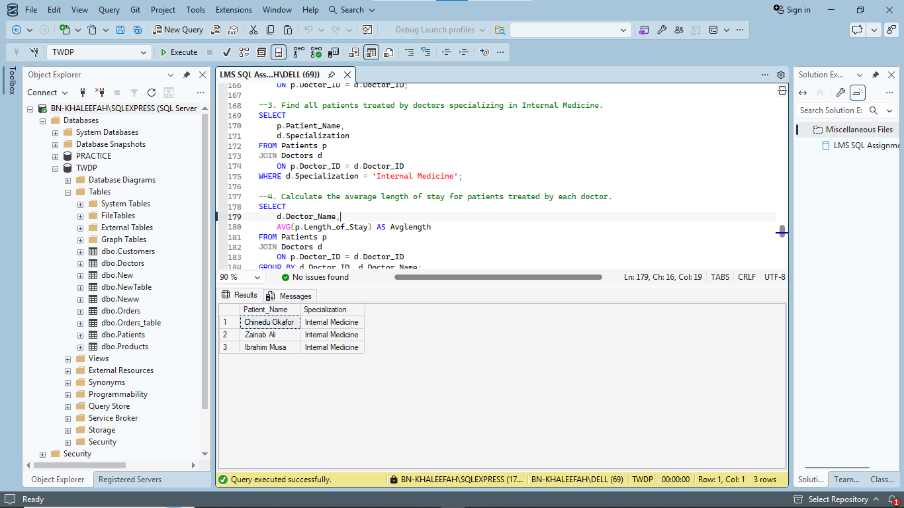
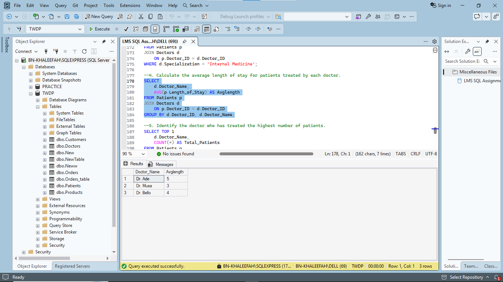
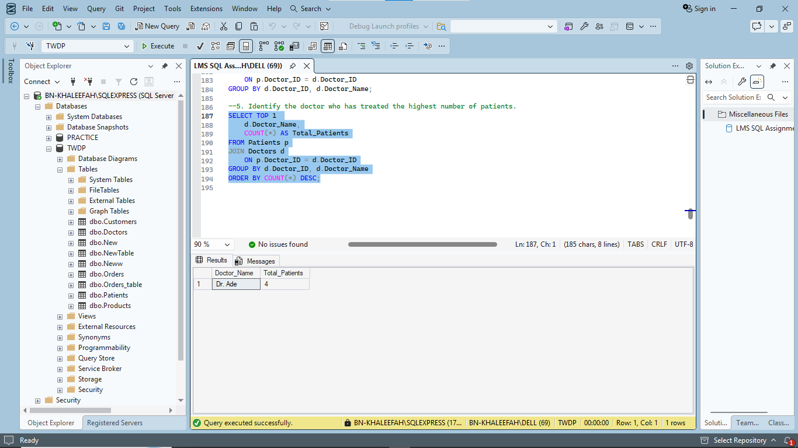
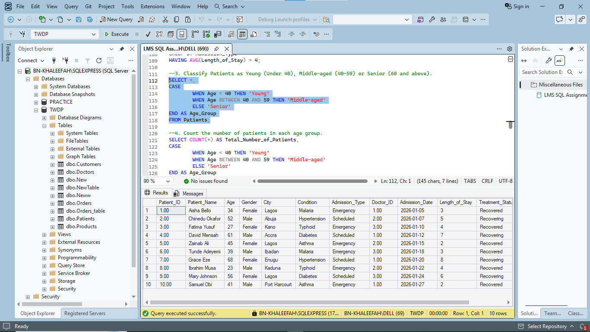

# Hospital Patient and Doctor Analysis Using SQL Server

## 📌 Project Overview

This project explores hospital patient and doctor records using Microsoft SQL Server. It focuses on examining relationships between patients and their assigned doctors, analysing medical specializations, calculating average patient length of stay, and identifying doctors with the highest patient workload.

## 📑 Table of Contents

1. [Project Objectives](#-project-objectives)
2. [SQL Analysis and Queries](#-sql-analysis-and-queries)
3. [Key Analytical Areas](#-key-analytical-areas)
4. [Recommendations](#-recommendations)
5. [Assumptions and Limitations](#️-assumptions-and-limitations)
6. [How to Run the Project](#-how-to-run-the-project)
7. [Tools and Technologies](#️-tools-and-technologies)
8. [Repository Structure](#-repository-structure)
9. [Author](#-author)
10. [About the Project](#-about-the-project)

## 🎯 Project Objectives

The major objectives of this project are to:

* Import and verify the Doctors table in SQL Server.
* Establish relationships between the Patients and Doctors tables.
* Retrieve patients treated by doctors specializing in Internal Medicine.
* Calculate the average length of stay for patients under each doctor.
* Identify the doctor who has treated the highest number of patients.

## 💻 SQL Analysis and Queries

### 1. Import and Verify the Doctors Table

The first task involves importing the Doctors table into SQL Server and verifying that the data was loaded correctly.

```sql
SELECT *
FROM Doctors;
```

**Query Result:** 
### Doctors Table Verification




### 2. Join Patients and Doctors Tables

An INNER JOIN was used to combine the Patients and Doctors tables to display each patient's name alongside their doctor's name and medical specialization.

```sql
SELECT 
    p.Patient_Name,
    d.Doctor_Name,
    d.Specialization
FROM Patients p
INNER JOIN Doctors d
    ON p.Doctor_ID = d.Doctor_ID;
```

**Query Result:**
### Patients and Doctors Join




### 3. Identify Patients Treated by Internal Medicine Specialists

This query filters the records to identify patients treated by doctors whose specialization is Internal Medicine.

```sql
SELECT
    p.Patient_Name,
    d.Specialization
FROM Patients p
INNER JOIN Doctors d
    ON p.Doctor_ID = d.Doctor_ID
WHERE d.Specialization = 'Internal Medicine';
```

**Query Result:**
### Internal Medicine Patients




### 4. Calculate Average Length of Stay per Doctor

The AVG() aggregate function was used alongside GROUP BY to calculate the average length of stay for patients treated by each doctor.

```sql
SELECT
    d.Doctor_ID,
    d.Doctor_Name,
    AVG(p.Length_of_Stay) AS Average_Length_of_Stay
FROM Patients p
INNER JOIN Doctors d
    ON p.Doctor_ID = d.Doctor_ID
GROUP BY
    d.Doctor_ID,
    d.Doctor_Name;
```

**Query Result:**
### Average Length of Stay




### 5. Identify the Doctor with the Highest Number of Patients

The COUNT() function was used to determine the number of patients treated by each doctor. TOP 1 and ORDER BY were applied to return the doctor with the highest patient count.

```sql
SELECT TOP 1
    d.Doctor_ID,
    d.Doctor_Name,
    COUNT(*) AS Total_Patients
FROM Patients p
INNER JOIN Doctors d
    ON p.Doctor_ID = d.Doctor_ID
GROUP BY
    d.Doctor_ID,
    d.Doctor_Name
ORDER BY
    COUNT(*) DESC;
```

**Query Result:**
### Doctor with Highest Patient Count




### 6. Classify Patients by Age Group Using CASE Statement

A CASE expression was used to classify patients into three age categories: Young (under 40), Middle-aged (40–59), and Senior (60 and above). This demonstrates conditional logic in SQL Server.

```sql
SELECT *,
    CASE
        WHEN Age < 40 THEN 'Young'
        WHEN Age BETWEEN 40 AND 59 THEN 'Middle-aged'
        ELSE 'Senior'
    END AS Age_Group
FROM Patients;
```

**Query Result:**
### Patient Age Group Classification




## 📊 Key Analytical Areas

| Analytical Area         | SQL Concepts Applied   | Purpose                                            |
| ----------------------- | ---------------------- | -------------------------------------------------- |
| Data Verification       | SELECT                 | Confirm successful data import                     |
| Table Relationships     | INNER JOIN             | Combine patient and doctor records                 |
| Specialization Analysis | WHERE                  | Filter patients by medical specialization          |
| Average Length of Stay  | AVG(), GROUP BY        | Examine average patient stay per doctor            |
| Doctor Workload         | COUNT(), TOP, ORDER BY | Identify the doctor with the highest patient count |

## 💡 Recommendations

Based on the analytical objectives of this project, the following recommendations may support hospital management:

1. **Doctor Workload Management:** Monitor the number of patients assigned to each doctor to support balanced workload distribution.
2. **Resource Allocation:** Use patient distribution across medical specializations to inform staffing and resource allocation.
3. **Length-of-Stay Monitoring:** Regularly examine average patient length of stay to identify areas requiring further operational investigation.
4. **Data Management:** Maintain accurate and consistent patient and doctor records to improve the reliability of healthcare reporting.
5. **Performance Monitoring:** Conduct periodic analysis of patient records to support evidence-based hospital management decisions.

## ⚠️ Assumptions and Limitations

* The Patients and Doctors tables contain the necessary fields required for the analysis.
* Doctor_ID serves as the linking key between the Patients and Doctors tables.
* The INNER JOIN returns only patients with matching doctor records.
* AVG() excludes NULL values when calculating average length of stay.
* The highest patient count is determined from the records available in the Patients table.
* The analysis is limited to the fields and records provided in the dataset.
* The project does not establish whether longer or shorter hospital stays indicate better clinical outcomes.

## 🚀 How to Run the Project

1. Clone or download this repository.
2. Open Microsoft SQL Server Management Studio (SSMS).
3. Connect to your SQL Server instance.
4. Create or select the appropriate database.
5. Import the Patients and Doctors datasets.
6. Open the SQL script in the repository.
7. Execute the queries individually or run the complete script.
8. Review the query results.

## 🛠️ Tools and Technologies

* **Microsoft SQL Server:** Relational database management and querying.
* **SQL Server Management Studio (SSMS):** SQL query development and execution.
* **SQL:** Data retrieval, filtering, joining, aggregation, and sorting.

## 📁 Repository Structure

```text
Hospital-Patient-and-Doctor-Analysis/
│
├── README.md
│
├── sql/
│   └── Hospital_Patient_Doctor_Analysis.sql
│
├── dataset/
│   ├── Patients.csv
│   └── Doctors.csv
│
└── images/
├── 01-doctors-table.png
├── 02-patients-doctors-join.png
├── 03-internal-medicine-patients.png
├── 04-average-length-of-stay.png
├── 05-doctor-highest-patient-count.png
└── 06-patient-age-group-classification.png
```

## 👨‍💻 Author

**Abdulmuiz Abdulazeez Arikewushola**

Data Analyst | SQL | Excel | Power BI | Python

* **GitHub:** [torshaw](https://github.com/torshaw)
* **Location:** Nigeria

## 📖 About the Project

The Hospital Patient and Doctor Analysis project is a practical SQL Server project developed to demonstrate the application of relational database querying in healthcare analytics.

Through five SQL tasks, the project demonstrates the ability to retrieve, combine, filter, and analyse hospital records using fundamental SQL concepts.

It also highlights how structured data analysis can provide useful information about doctor workload, medical specializations, and patient length of stay.

*Turning data into meaningful insights through analytical thinking and practical problem-solving.*
